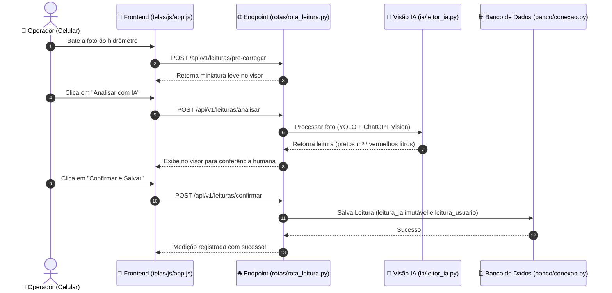

# 🏛️ Arquitetura e Guia de Diretórios - HidroReader

Este documento descreve detalhadamente o padrão arquitetural do **HidroReader Mobile**, suas camadas de responsabilidade e as diretrizes para manutenção e deploy em **produção**.

---

## 🎯 Princípios Arquiteturais

O sistema é construído sobre os pilares da **Clean Architecture** adaptada para **FastAPI**:

1. **Separação Estrita de Responsabilidades:** Cada diretório possui um único propósito bem definido.
2. **Custo Mínimo de Operação:** Otimização para visão computacional com `gpt-4o-mini`, redimensionamento em 1 tile e cache LRU por hash SHA-256.
3. **Dupla Verificação e Resiliência:** 1ª verificação com recorte YOLO e 2ª verificação com ChatGPT Vision, com contingência automática se o visor estiver em ângulo difícil.
4. **Pronto para Produção (12-Factor App):** Configurações externas via variáveis de ambiente (`.env`), suporte a containers (`Docker`), persistência flexível (SQLite local ou PostgreSQL em produção) e health checks para monitoramento.

---

## 📂 Guia Detalhado de Cada Diretório

### 1. Diretórios da Aplicação

| Diretório | Responsabilidade | O que DEVE ter aqui | O que NÃO deve ter aqui |
| :--- | :--- | :--- | :--- |
| **`rotas/`** | **Camada HTTP / Endpoints** | Roteadores FastAPI dedicados (`rota_login.py`, `rota_apartamentos.py`, `rota_leitura.py`, `rota_dashboard.py`, `rota_paginas.py`). | Consultas SQL pesadas diretas ou inferência direta de redes neurais. |
| **`banco/`** | **Conexão e Modelos ORM** | Configuração do SQLAlchemy (`conexao.py`) e tabelas relacionais (`modelos.py`: `Usuario`, `Apartamento`, `Leitura`). | Rotas HTTP, regras visuais. |
| **`seguranca/`** | **Autenticação e Sessão** | Hashing de senhas, criação e validação de tokens JWT (`autenticacao.py`). | Lógica de negócio de apartamentos ou fotos. |
| **`ia/`** | **Visão Computacional e IA** | Pipeline de Visão (`leitor_ia.py`): detecção/recorte com YOLO, leitura com OpenAI `gpt-4o-mini` e Gemini Vision de contingência. | Endpoints HTTP diretos. |
| **`telas/`** | **Frontend Mobile** | Interface Web responsiva: HTMLs (`login.html`, `dashboard.html`, `leitor.html`), estilos e scripts (`js/app.js`). | Códigos Python ou arquivos de backend. |
| **`modelos_ia/`** | **Pesos de Machine Learning** | Arquivos de pesos treinados das redes neurais (`pegarvisor.pt`). | Códigos Python ou datasets brutos. |

---

## 💰 Arquitetura de Custo Mínimo de IA

| Camada de Otimização | Estratégia Implementada | Impacto no Custo |
| :--- | :--- | :--- |
| **Modelo** | OpenAI `gpt-4o-mini` | Mais de 90% mais barato que modelos topo de linha |
| **Tiles de Imagem** | Redimensionamento para 1 único tile de 512px | De 1.000+ tokens para apenas **255 tokens** por foto |
| **Output Tokens** | `max_tokens=150` com JSON estrito | Elimina saídas prolixas e alucinações |
| **Cache SHA-256** | Cache local em memória por hash da imagem | Fotos repetidas ou reanalisadas custam **R$ 0,00** |
| **Contingência** | YOLO recorta visor -> Se falhar, ChatGPT lê a foto inteira | Evita fotos perdidas ou operadores bloqueados |

---

## 🔄 Fluxo de Uma Requisição (Passo a Passo)

