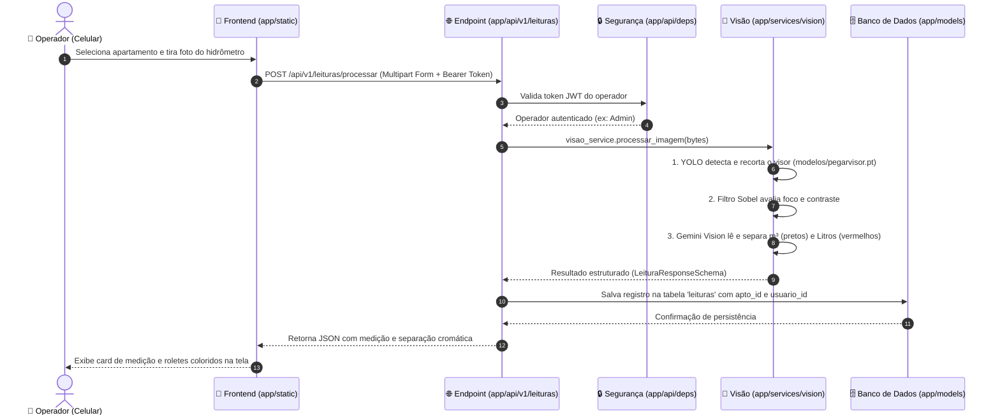

# 🏛️ Arquitetura e Guia de Diretórios - HidroReader

Este documento descreve detalhadamente o padrão arquitetural do **HidroReader Mobile**, suas camadas de responsabilidade e as diretrizes para manutenção e deploy em **produção**.

---

## 🎯 Princípios Arquiteturais

O sistema é construído sobre os pilares da **Clean Architecture** adaptada para **FastAPI**:

1. **Separação Estrita de Responsabilidades:** Cada diretório possui um único propósito bem definido.
2. **Desacoplamento:** A interface web (`app/static/`) não acessa banco de dados; a API (`app/api/`) não implementa redes neurais diretamente; a IA (`app/services/vision/`) não lida com requisições HTTP.
3. **Pronto para Produção (12-Factor App):** Configurações externas via variáveis de ambiente (`.env`), suporte a containers (`Docker`), persistência flexível (SQLite local ou PostgreSQL em produção) e health checks para monitoramento.

---

## 📂 Guia Detalhado de Cada Diretório

### 1. `app/` — Núcleo da Aplicação
Contém todo o código da aplicação. Nada de regras de negócio ou telas deve ficar fora de `app/`.

| Subdiretório | Responsabilidade | O que DEVE ter aqui | O que NÃO deve ter aqui |
| :--- | :--- | :--- | :--- |
| **`app/api/`** | **Camada HTTP** | Roteadores FastAPI, endpoints REST, injeção de dependências (`deps.py`), validação de tokens JWT. | Consultas SQL diretas, lógica pesada de visão computacional. |
| **`app/core/`** | **Fundação do Sistema** | Leitura de `.env` (`config.py`), conexão com banco (`database.py`), criptografia e JWT (`security.py`), scripts de seed (`init_db.py`). | Rotas HTTP, templates visuais. |
| **`app/models/`** | **Modelos ORM (Banco)** | Classes SQLAlchemy que mapeiam tabelas relacionais (`Usuario`, `Apartamento`, `Leitura`). | Schemas Pydantic, lógica de rotas. |
| **`app/schemas/`** | **Contratos de Dados (DTO)** | Schemas Pydantic para validar entradas e saídas de dados com tipagem estrita e documentação automática no Swagger. | Consultas a banco de dados. |
| **`app/services/`** | **Regras de Negócio e IA** | Pipeline de Visão Computacional (`services/vision/pipeline.py`), chamada aos modelos YOLO e integração com a API Gemini Vision. | Lógica de respostas HTTP diretas. |
| **`app/static/`** | **Frontend Mobile** | Interface Web responsiva: HTMLs (`login.html`, `index.html`), folhas de estilo (`css/mobile.css`) e scripts do cliente (`js/`). | Códigos Python ou arquivos de backend. |

---

### 2. `modelos/` — Pesos e Modelos de Machine Learning
- **Propósito:** Armazenamento centralizado de pesos de redes neurais (`.pt`, `.h5`, `.onnx`).
- **Arquivos Atuais:**
  - `pegarvisor.pt`: Modelo treinado YOLO para detecção e recorte preciso do mostrador mecânico.
  - `modelo_hidrometro.h5`: Modelo histórico preservado para referência.

---

### 3. `experimentos/` — Scripts de Teste e Amostras
- **Propósito:** Isolar códigos de laboratório, testes de acurácia manuais e imagens de exemplo para não poluir o código de produção.
- **Arquivos:** Scripts exploratórios como `pegar_visor.py` e pastas com amostras de fotos.

---

### 4. Arquivos de Raiz
- **`run.py`**: Ponto de partida único para iniciar o servidor em desenvolvimento (descobre o IP da rede Wi-Fi para testes no celular).
- **`Dockerfile` & `docker-compose.yml`**: Configurações de container otimizadas para deploy em produção.
- **`.env` / `.env.example`**: Configurações de chaves e variáveis de ambiente.
- **`hidroreader.db`**: Banco de dados SQLite padrão para desenvolvimento.

---

## 🔄 Fluxo de Uma Requisição (Passo a Passo)



---

## 🚀 Checklist para Deploy em Produção

Quando você for publicar o sistema em um servidor na nuvem (AWS, DigitalOcean, VPS, Render, etc.):

1. **Trocar a Chave Secreta no `.env`:**
   ```bash
   SECRET_KEY="gere_uma_chave_aleatoria_longa_e_segura"
   ```
2. **Definir o Ambiente:**
   ```bash
   ENVIRONMENT="production"
   DEBUG=False
   ```
3. **CORS Restrito:**
   No `.env`, limite `CORS_ORIGINS` para o domínio real do seu aplicativo (ex: `https://app.hidroreader.com.br`).
4. **Deploy com Docker (Recomendado):**
   ```bash
   docker compose up -d --build
   ```
5. **Monitoramento e Health Check:**
   O container possui monitoramento contínuo apontando para `http://localhost:8000/health`, verificando a integridade da API, do banco de dados e do modelo de IA.

